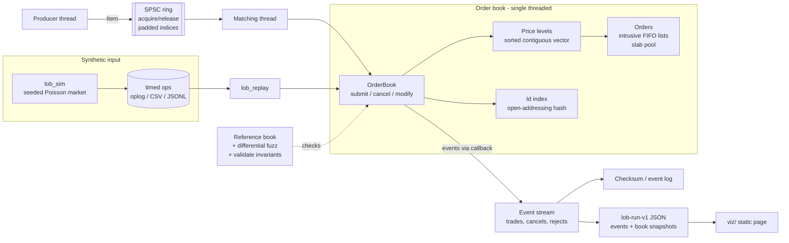

# lob-engine

[](https://github.com/alags21/lob-engine/actions/workflows/ci.yml)
[](LICENSE)


A C++20 limit order book and matching engine, built stage by stage with a correctness-first test
strategy: price-time priority matching (limit, market, IOC, FOK, cancel, modify), a slow reference
model and seeded differential fuzzing, reproducible benchmarks, a lock-free single-producer pipeline,
a browser visualizer, and a validation run over one real Nasdaq ITCH trading day
(the raw data is not included).

What is measured and what is not is stated next to every number. All tables below are generated from
saved result files by scripts (`scripts/make_report.py`, `scripts/make_mt_report.py`,
`scripts/make_platform_report.py`, `scripts/make_realdata_report.py`); none are typed by hand. See [Limitations](docs/DESIGN.md#limitations) before quoting any of them.

New here? Start with the one-page [docs/OVERVIEW.md](docs/OVERVIEW.md) (architecture, features, tradeoffs, gaps).

## Highlights
- **Correct by construction:** a slow reference model, seeded differential fuzzing against it, and invariants
  checked after every call in Debug builds; sanitizers (ASan, UBSan, TSan) in CI.
- **Fast without cutting corners:** five measured optimisation steps, each gated by the correctness suite,
  ending with no allocations on the hot path (tables below).
- **Honest about tradeoffs:** the lock-free queue wins against a mutex queue and loses to locking the book;
  that result is reported, not hidden, and holds on every platform tested.
- **Validated on real data:** one full Nasdaq ITCH 5.0 trading day replayed through the engine.
- **Portable:** x86-64 and arm64, Linux, macOS and Windows, all built and tested in CI.

## Architecture



- The book is single-threaded and deterministic: the same ops always give the same events.
- Concurrency lives outside the book: one producer, one lock-free queue, one matching thread. The
  multi-threaded event stream is checked to be identical to the single-thread one.
- Design decisions, rejected alternatives and limitations: [docs/DESIGN.md](docs/DESIGN.md).

## Quick start

Linux (Ubuntu or similar):

```
sudo apt-get install -y cmake ninja-build g++ libgtest-dev libbenchmark-dev
cmake -S . -B build -G Ninja -DCMAKE_BUILD_TYPE=Release
cmake --build build
ctest --test-dir build --output-on-failure
```

Windows (MSVC Build Tools plus a conda env for CMake, Ninja and GoogleTest; exact steps in
[docs/BENCHMARKING.md](docs/BENCHMARKING.md)):

```
conda create -n lob -c conda-forge cmake ninja cxx-compiler gtest benchmark clang-format
scripts\win-build.cmd build-rel
```

Try it:

```
build/tools/lob_sim --seed 7 --ops 8000 --csv run.csv          # generate a synthetic order flow
build/tools/lob_replay run.csv | head                           # replay it, print events
build/tools/lob_replay --js viz/data/my_run.js run.csv          # export a run for the visualizer
```

Then open `viz/index.html` in a browser (no server needed).

## Benchmarks

Single-thread book, closed loop, one Windows desktop (not isolated); other platforms are in the cross-platform table below. Method, environment, variance
and every step: [docs/PERFORMANCE.md](docs/PERFORMANCE.md).

<!-- BEGIN GENERATED:perf -->
Baseline `00-baseline` vs `05-linear-scan-levels` (medians of repeated runs; see docs/PERFORMANCE.md for method, variance and every step).

| workload | baseline Mops/s | final Mops/s | speedup | baseline p99 ns | final p99 ns | baseline p99.9 ns | final p99.9 ns | allocs/op before -> after |
|---|---|---|---|---|---|---|---|---|
| passive | 4.79 | 11.53 | 2.41x | 631 | 281 | 1483 | 521 | 0.864 -> 0.000 |
| aggressive | 5.79 | 12.88 | 2.22x | 701 | 301 | 1573 | 551 | 0.764 -> 0.000 |
| balanced | 4.66 | 9.32 | 2.00x | 741 | 381 | 1723 | 771 | 0.811 -> 0.000 |
<!-- END GENERATED:perf -->

Where the speed came from, step by step (one commit each, each gated by the correctness suite):

<!-- BEGIN GENERATED:perf-steps -->
Speedup over the Stage 1 baseline (ratio of median throughput; the last row is the drift check, so differences smaller than its distance from 1.00x are not meaningful).

| step | change | passive | aggressive | balanced |
|---|---|---|---|---|
| 01-intrusive-lists | Intrusive doubly linked order nodes (new/delete) instead of std::list; kept (no gain on its own; prerequisite for the pool) | 0.99x | 1.04x | 0.98x |
| 02-node-pool | Slab + free-list pool for order nodes; kept | 1.17x | 1.12x | 1.16x |
| 03-flat-id-map | Open-addressing flat hash table for id lookup; kept | 1.82x | 1.75x | 1.66x |
| 04-contiguous-levels | Sorted contiguous vector of price levels (best last), binary search; kept | 1.97x | 1.90x | 1.64x |
| 05-linear-scan-levels | Level lookup by scanning from the best level; kept | 2.41x | 2.22x | 2.00x |
| 99-baseline-rerun | unchanged baseline binary measured again (drift check) | 0.98x | 0.95x | 0.92x |
<!-- END GENERATED:perf-steps -->

Producer thread -> queue -> matching thread, same workloads and harness. The lock-free queue beats a
mutex+condvar queue but loses to simply locking the book, and reaches only a fraction of the single-thread
ceiling; the full analysis, ablations (padding, slot alignment, wait strategy, event callback) and
caveats are in [docs/CONCURRENCY.md](docs/CONCURRENCY.md).

<!-- BEGIN GENERATED:mt -->
Stage 4, producer thread -> queue -> matching thread (medians of repeated runs; latency measured from the intended send time at a fixed paced rate; see docs/CONCURRENCY.md for method, ablations and caveats).

| workload | single-thread Mops/s | SPSC Mops/s | mutex+condvar Mops/s | mutex-book Mops/s | SPSC paced p99 ns | mutex+condvar paced p99 ns | mutex-book paced p99 ns |
|---|---|---|---|---|---|---|---|
| passive | 11.15 | 5.42 | 3.32 | 8.60 | 364113 | 390838 | 175498 |
| aggressive | 12.85 | 6.05 | 3.39 | 9.64 | 371021 | 463838 | 167277 |
| balanced | 9.95 | 5.22 | 3.11 | 8.19 | 412628 | 1893520 | 148974 |

- `passive`: SPSC is 1.64x the mutex+condvar queue (a win) and 0.63x the mutex-protected book (a LOSS: the lock-only design with no hand-off is faster); it reaches 49% of the single-thread ceiling. Paced median latency 355 ns vs 970 ns (mutex+condvar) and 226 ns (mutex-book).
- `aggressive`: SPSC is 1.79x the mutex+condvar queue (a win) and 0.63x the mutex-protected book (a LOSS: the lock-only design with no hand-off is faster); it reaches 47% of the single-thread ceiling. Paced median latency 323 ns vs 980 ns (mutex+condvar) and 198 ns (mutex-book).
- `balanced`: SPSC is 1.68x the mutex+condvar queue (a win) and 0.64x the mutex-protected book (a LOSS: the lock-only design with no hand-off is faster); it reaches 52% of the single-thread ceiling. Paced median latency 353 ns vs 988 ns (mutex+condvar) and 222 ns (mutex-book).

Tail latency (p99 and above) on this machine is dominated by OS interference; see docs/CONCURRENCY.md.
<!-- END GENERATED:mt -->

### Cross-platform check

Linux (x86-64 and arm64), macOS (Apple Silicon and Intel) and Windows are built and tested in CI, and the
same benchmark ran on each as a consistency check. The finding is the same everywhere: the lock-free queue
beats a mutex+condvar queue but not simply locking the book.

<!-- BEGIN GENERATED:platforms -->
Same code and harness on GitHub-hosted shared VMs (`.github/workflows/bench-platforms.yml`, one run, medians of 7 repetitions per workload; the ratios compare designs measured in the same job). Absolute ops/s and tail latency are not reliable on shared VMs and macOS threads are not pinned; see [docs/PLATFORMS.md](docs/PLATFORMS.md).

| platform | CPU | single-thread Mops/s (passive/aggressive/balanced) | SPSC vs mutex+condvar queue | SPSC vs mutex-protected book | SPSC vs single-thread ceiling |
|---|---|---|---|---|---|
| linux-x86_64 | AMD EPYC 7763 64-Core Processor | 22.7/26.1/20.7 | 3.16x to 3.48x | 0.69x to 0.73x | 0.59x to 0.63x |
| linux-arm64 | Neoverse-N2 | 26.2/30.5/24.3 | 7.36x to 7.79x | 0.83x to 1.13x | 0.58x to 0.82x |
| macos-arm64 | Apple M1 (Virtual) | 25.5/28.6/23.4 | 1.90x to 2.00x | 0.82x to 0.87x | 0.67x to 0.74x |
| macos-x86_64 | Intel(R) Core(TM) i7-8700B CPU @ 3.20GHz | 14.1/17.7/14.3 | 1.76x to 3.41x | 0.69x to 0.76x | 0.44x to 0.47x |
| windows-x86_64 | AMD EPYC 9V74 80-Core Processor | 24.1/26.6/21.5 | 3.37x to 3.64x | 0.78x to 0.80x | 0.67x to 0.69x |

Every one of the 165 queue runs above matched the single-thread event checksum. Ratios are a range over the three workloads.
<!-- END GENERATED:platforms -->

## Validation on real Nasdaq data

The engine was replayed over a full day of real Nasdaq ITCH 5.0 messages (one trading day, 30 July 2019; the
raw file is not in this repository and is not redistributable). Method, mapping, the hypotheses tested for
the deviations from strict FIFO, and the replay benchmark: [docs/REALDATA.md](docs/REALDATA.md). Generated
by `scripts/make_realdata_report.py` from `bench/results/realdata/*.json`.

<!-- BEGIN GENERATED:realdata -->
Real Nasdaq ITCH 5.0 data, one trading day (30 July 2019), 278,286,223 decoded messages across 8,849 symbols (282,229,684 frames in the file, 0 malformed). Every message was replayed through the engine; selected symbols were also run through the Stage 2 reference model.

| check | result |
|---|---|
| order-state violations (unknown/duplicate reference, over-execute, over-cancel, our size differs from the exchange's, rejected operation) | **0** |
| executions checked in continuous trading (engine picks the maker) | 7,631,594 |
| engine chose the exact order the exchange executed | 7,516,230 (98.49%) |
| deviations from strict FIFO (a different order at the same price) | 115,363 (1.51%) |
| price-priority violations (an order at a better price was skipped) | 1 |
| executions where the engine found no fill | 0 |
| reference-model comparisons (BBO, all levels, queue order) on 5 symbols | 1,027 comparisons, 0 disagreements |

Real-stream replay (pre-decoded, pinned, 7 repetitions): 12,949,905 engine operations over 10 books, 6.25 Mops/s median (CV 4.4%), p50 150 ns, p99 822 ns, p99.9 2074 ns.
<!-- END GENERATED:realdata -->

## Visualizer

`viz/index.html` is a static page (plain HTML, canvas and JS; no build, no network, works from
`file://`): animated depth chart, trade tape, mid price and spread, order-flow stats and a latency
histogram from the saved benchmark results, with play/pause/step/speed/scrub and keyboard control.
It ships with a sample run of the C++ engine on synthetic orders.


## How to verify

| What | Command |
|---|---|
| Unit, replay, stress and pipeline tests | `ctest --test-dir build --output-on-failure` |
| Differential fuzz vs the reference model | `build/tests/lob_fuzz --seed 1 --ops 1000000 --runs 2` (prints every seed; a failure writes a replayable op log) |
| Invariants after every call | build without `NDEBUG` (Debug); `OrderBook::validate()` runs on every mutating call |
| ASan + UBSan | `cmake -DLOB_SANITIZE=ON -DCMAKE_BUILD_TYPE=Debug ...` (Linux, clang or gcc) |
| ThreadSanitizer | `cmake -DLOB_TSAN=ON ...` then run `lob_tests --gtest_filter='SpscQueue.*:SpscStress.*:Pipeline.*'`; CI also requires TSan to flag a deliberately racy queue (`-DLOB_RACY_DEMO=ON`) |
| Benchmarks (Windows example) | `scripts\win-build.cmd build-rel` then `python scripts/run_bench.py --label NAME`, `python scripts/run_mt_bench.py`; multi-commit comparison: `python scripts/remeasure.py` |
| Benchmarks on another machine | `scripts/bench_macos.sh` (Apple Silicon) or `scripts\bench_windows.ps1`; see [docs/PLATFORMS.md](docs/PLATFORMS.md) |
| Regenerate the tables | `python scripts/make_report.py` and `python scripts/make_mt_report.py` (add `--check` to fail if a file would change) |
| Regenerate visualizer data | `python scripts/make_viz_data.py --sim <absolute path to lob_sim>` |
| Visualizer tests | `node viz/test/viz_test.js` (mock canvas and fake DOM; pixels are checked only by screenshot, see DESIGN) |

CI (`.github/workflows/ci.yml`) runs the build matrix (gcc and clang, Release and Debug), the
sanitizer jobs, the fuzz runs, a benchmark smoke run (timings from CI are never reported) and the
visualizer job. A nightly longer fuzz workflow exists but only runs once it is on `main`.

## Project status

Documentation index: [OVERVIEW](docs/OVERVIEW.md), [DESIGN](docs/DESIGN.md), [RESULTS](docs/RESULTS.md),
[PERFORMANCE](docs/PERFORMANCE.md), [CONCURRENCY](docs/CONCURRENCY.md), [REALDATA](docs/REALDATA.md),
[EVENT_FORMAT](docs/EVENT_FORMAT.md), [BENCHMARKING](docs/BENCHMARKING.md), [PLATFORMS](docs/PLATFORMS.md).

See [docs/RESULTS.md](docs/RESULTS.md) for what each stage added, the measured results and the known
gaps, and [docs/DESIGN.md](docs/DESIGN.md) for design tradeoffs and limitations. Released under the
[MIT License](LICENSE).
